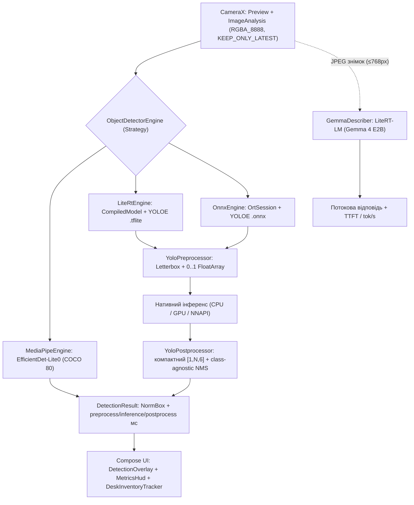

# 🧪 Android ML Playground (`dev.onelenyk.mlplayground`)

Proof-of-Concept Android-застосунок для тестування, живого порівняння та бенчмаркінгу **локального машинного навчання на пристрої (On-Device ML)** без інтернету та серверних API. Протестовано на **Google Pixel 7a** (Tensor G2, Mali-G710, 8 ГБ RAM, Android 17).

Застосунок поєднує три різні способи інтеграції детекції об'єктів (**MediaPipe**, **LiteRT**, **ONNX Runtime**) за єдиним контрактом та мультимодальну локальну VLM (**Gemma 4 E2B** через **LiteRT-LM**) для детального опису сцени українською мовою.

---

## Можливості (3 вкладки)

### 1. 🔍 Сканер (`Desk Scanner`)
Жива детекція об'єктів з камери (`CameraX Preview + ImageAnalysis`, `RGBA_8888`, `KEEP_ONLY_LATEST`):
- **Живі рамки та HUD метрик:** `FPS`, загальна затримка та розбивка `Pre / Inf / Post` (мс), активний делегат (`CPU` / `GPU` з індикатором fallback).
- **Список «На столі» (`DeskInventoryTracker`):** ковзне вікно по останніх 8 кадрах прибирає мерехтіння одиничних спрацьовувань і показує медіанну кількість предметів (`laptop ×1`, `cat ×1`, `watch ×1`).
- **Пошук предмета (`Find My Item`):** тап по чипу зі списку або текстовий запит підсвічує шуканий об'єкт яскраво-зеленим контуром і дає легку вібрацію (`HapticFeedback`), коли предмет потрапляє в кадр.
- **Гаряче перемикання без перезапуску камери:** вибір рушія (`MediaPipe` / `LiteRT` / `ONNX Runtime`), делегата (`CPU` / `GPU`), вхідного розміру (`320px` / `640px`) та слайдера порогу впевненості (`0.15..0.80`).

### 2. ✨ Опис AI (`Gemma 4 E2B`)
Локальна мультимодальна мовна модель (VLM) для випадків, коли потрібно не просто визначити клас, а описати сцену детально (кольори, стан, бренди, контекст):
- **Потокова відповідь (streaming)** українською мовою у реальному часі.
- **Пресет-промпти:** «Список предметів», «Детальний опис», «Що зайве?» + довільний текстовий промпт.
- **Керування ресурсами:** перемикач `GPU` / `CPU`, режим `Thinking` (опціонально, з окремим виводом роздумів), кнопка **«Вивантажити модель»** для звільнення RAM.
- **Телеметрія VLM:** `TTFT` (Time-To-First-Token), швидкість `Prefill` і `Decode` (`tok/s`), кількість токенів і загальний час відповіді.

### 3. 📊 Бенчмарк (`Benchmark Lab`)
Об'єктивне порівняння рушіїв на однакових вхідних даних:
- **Режим «1 кадр» (`Same Frame Compare`):** заморожує один кадр із камери і по черзі проганяє його через усі 3 рушії (`MediaPipe`, `LiteRT`, `ONNX Runtime`) на обраному делегаті (`CPU` або `GPU`), показуючи рамки поверх знімка і порівняльну таблицю.
- **Режим «Автопрогін» (`Auto Run`):** послідовно тестує всі 6 комбінацій (`3 рушії × CPU/GPU`) із прогрівом (`5` кадрів) та заданою кількістю вимірювань (`20 / 50 / 100` прогонів). Рахує `Mean`, `p50`, `p95`, `FPS`, споживання пам'яті (`JVM + Native Heap MB`).
- **Графік троттлінгу:** будує криві часу інференсу по кожному прогону для виявлення нагріву й падіння частот.
- **Експорт звітів:** автоматичне збереження у `CSV` та `JSON` у зовнішню директорію застосунку (для `adb pull`) + кнопка «Поділитися» через `FileProvider`.

---

## Порівняння ML-інтеграцій

| Рушій | Бібліотека | Модель | Словник | Вхід / Вихід | Особливості інтеграції |
| :--- | :--- | :--- | :--- | :--- | :--- |
| **MediaPipe Tasks Vision** | `tasks-vision:1.2.3` | `efficientdet_lite0.tflite` | COCO (80 класів) | Bitmap → `ObjectDetectorResult` | «Чорна скринька»: ресайз, нормалізація та NMS усередині нативного шару. Мінімум коду, але обмежений вибір моделей. |
| **LiteRT** (ex-TFLite) | `litert:2.4.0` + `litert-gpu` | `yoloe_pf_{320,640}.tflite` (FP16) | YOLOE Prompt-Free (**4 585 класів**) | NHWC `[1,S,S,3]` → `[1,N,6]` | Новий `CompiledModel` API, OpenCL/GLES GPU-делегат або XNNPACK CPU (4 потоки), повний контроль над пре- та постпроцесингом. |
| **ONNX Runtime** | `onnxruntime-android:1.32.0` | `yoloe_pf_{320,640}.onnx` (FP32) | YOLOE Prompt-Free (**4 585 класів**) | NCHW `[1,3,S,S]` → `[1,N,6]` | `OrtSession` із XNNPACK EP (CPU) або NNAPI EP (апаратні прискорювачі). Перевикористовує спільний YOLO пре/постпроцесор для чесного порівняння з LiteRT. |
| **LiteRT-LM** | `litertlm-android:0.19.1` | `gemma-4-E2B-it.litertlm` (~2.59 ГБ) | Відкрита мова + зір | JPEG (`≤768px`) + текст → `Flow<Message>` | Зовнішній файл (не вшивається в APK), підтримка `Backend.GPU()` / `Backend.CPU()`, потокова генерація й `BenchmarkInfo`. |

> **Компактний вихід YOLOE `[1, N, 6]`:** при експорті в [export_models.py](tools/export_models.py) до голови YOLOE-11s додано обгортку `max`/`argmax` по всіх 4 585 класах усередині графа (без коефіцієнтів масок сегментації). Замість ~39 млн float (~155 МБ на кадр) модель повертає компактний тензор `(cx, cy, w, h, score, class_id)` (`N = 2100` для `320px` і `N = 8400` для `640px`), де координати нормалізовані в `[0..1]`, а `score` вже після `sigmoid`. На телефоні застосовується class-agnostic NMS ([YoloPostprocessor.kt](app/src/main/kotlin/dev/onelenyk/mlplayground/ml/yolo/YoloPostprocessor.kt)), щоб прибирати дублікати синонімів.

---

## Архітектура

Усі детектори реалізують спільний інтерфейс `ObjectDetectorEngine` (**Strategy Pattern**), тож камера (`CameraX`) та UI (`DetectionOverlay`) ізольовані від конкретного ML-рушія. Кожен режим має власний однопотоковий `Executor` (`ml-scanner`, `ml-benchmark`, `ml-vlm`) для безпечної роботи з нативними ресурсами, а `CameraPreview` прив'язується лише до активної вкладки.



---

## Структура проєкту

```text
android-playground/
├── app/src/main/
│   ├── AndroidManifest.xml                  # Дозвіл камери, OpenCL/Mali native libs, FileProvider
│   ├── assets/
│   │   ├── yoloe_pf_labels.txt              # 4 585 класів YOLOE (у Git)
│   │   ├── efficientdet_lite0.tflite        # Генерується скриптом (ігнорується Git)
│   │   ├── yoloe_pf_{320,640}.tflite        # Генерується скриптом (ігнорується Git)
│   │   └── yoloe_pf_{320,640}.onnx          # Генерується скриптом (ігнорується Git)
│   ├── kotlin/dev/onelenyk/mlplayground/
│   │   ├── MainActivity.kt                  # Точка входу, Camera permission gate, NavigationBar (3 вкладки)
│   │   ├── camera/CameraPreview.kt          # CameraX Preview + ImageAnalysis у вертикальний ARGB_8888 Bitmap
│   │   ├── ml/
│   │   │   ├── core/                        # Engine.kt, Assets.kt, EngineFactory.kt
│   │   │   ├── mediapipe/MediaPipeEngine.kt # Рушій №1: MediaPipe Tasks Vision
│   │   │   ├── litert/LiteRtEngine.kt       # Рушій №2: LiteRT CompiledModel (CPU/GPU)
│   │   │   ├── onnx/OnnxEngine.kt           # Рушій №3: ONNX Runtime (XNNPACK/NNAPI)
│   │   │   ├── yolo/                        # YoloPreprocessor.kt, YoloPostprocessor.kt, YoloModels.kt
│   │   │   └── vlm/GemmaDescriber.kt        # LiteRT-LM обгортка над Gemma 4 E2B
│   │   └── ui/
│   │       ├── common/                      # DetectionOverlay.kt, MetricsHud.kt
│   │       ├── scanner/                     # ScannerScreen.kt, ScannerViewModel.kt, DeskInventoryTracker.kt
│   │       ├── describe/                    # DescribeScreen.kt, DescribeViewModel.kt
│   │       ├── benchmark/                   # BenchmarkScreen.kt, BenchmarkViewModel.kt, BenchmarkModels.kt
│   │       └── theme/                       # Color.kt, Theme.kt, Type.kt
│   └── res/xml/file_paths.xml               # Шляхи FileProvider для експорту CSV/JSON
├── app/src/test/kotlin/dev/onelenyk/mlplayground/
│   ├── ml/yolo/YoloPostprocessorTest.kt     # Юніт-тести декодування [1,N,6], letterbox та class-agnostic NMS
│   └── ui/scanner/DeskInventoryTrackerTest.kt # Юніт-тести згладжування списку предметів
└── tools/
    ├── export_models.py                     # Завантаження EfficientDet + експорт YOLOE (.tflite / .onnx)
    ├── verify_models.py                     # Перевірка збігу детекцій між ONNX Runtime і LiteRT на фото
    └── README.md                            # Коротка шпаргалка по Python-оточенню та моделям
```

---

## Швидкий старт (збірка з нуля)

> **Примітка щодо великих файлів:** у [.gitignore](.gitignore) виключено бінарні моделі (`*.tflite`, `*.onnx`, `*.litertlm`, `*.task`), `tools/.venv/` та `tools/work/`. Тому перед першою збіркою APK потрібно згенерувати моделі детекції скриптом.

### 1. Передумови
- **JDK 17+** (використовується JVM toolchain 17)
- **Android SDK** (`compileSdk 36`, `minSdk 26`, `arm64-v8a`) та `adb`
- **[`uv`](https://docs.astral.sh/uv/)** для ізольованого Python 3.12 (системний Python 3.14 може не мати wheel-пакетів для PyTorch)

### 2. Експорт і верифікація моделей детекції
```bash
uv venv --python 3.12 tools/.venv
uv pip install --python tools/.venv/bin/python ultralytics onnx onnxruntime onnxsim onnx2tf ai-edge-litert pillow

# Створює efficientdet_lite0.tflite та yoloe_pf_{320,640}.{tflite,onnx} у app/src/main/assets/
tools/.venv/bin/python tools/export_models.py --sizes 640 320

# Перевіряє, що ONNX Runtime та LiteRT дають узгоджені детекції на тестовому фото
tools/.venv/bin/python tools/verify_models.py
```

### 3. Юніт-тести, збірка та встановлення на пристрій
```bash
./gradlew :app:testDebugUnitTest :app:assembleDebug

adb install -r app/build/outputs/apk/debug/app-debug.apk
adb shell pm grant dev.onelenyk.mlplayground android.permission.CAMERA
adb shell am start -n dev.onelenyk.mlplayground/.MainActivity
```

### 4. Підготовка Gemma 4 E2B для вкладки «Опис AI»
Модель `gemma-4-E2B-it.litertlm` (~2.59 ГБ, ліцензія Apache 2.0, без gated-доступу) не входить до APK і завантажується на пристрій окремо:

```bash
mkdir -p tools/work
curl -L -C - "https://huggingface.co/litert-community/gemma-4-E2B-it-litert-lm/resolve/main/gemma-4-E2B-it.litertlm" \
  -o tools/work/gemma-4-E2B-it.litertlm

adb shell mkdir -p /sdcard/Android/data/dev.onelenyk.mlplayground/files/models
adb push tools/work/gemma-4-E2B-it.litertlm \
  /sdcard/Android/data/dev.onelenyk.mlplayground/files/models/gemma-4-E2B-it.litertlm
```

*(Також застосунок шукає файл у `/data/local/tmp/gemma-4-E2B-it.litertlm` як резервний шлях).*

---

## Стек технологій

Версії зафіксовано у [gradle/libs.versions.toml](gradle/libs.versions.toml):

| Компонент | Версія |
| :--- | :--- |
| Android Gradle Plugin | `9.0.1` (Gradle `9.1.0`) |
| Kotlin | `2.3.20` |
| Jetpack Compose BOM | `2026.03.01` (Material 3) |
| AndroidX Core / Lifecycle / Activity | `1.18.0` / `2.10.0` / `1.13.0` |
| CameraX (`core`, `camera2`, `lifecycle`, `view`) | `1.7.0` |
| MediaPipe Tasks Vision | `1.2.3` |
| LiteRT + LiteRT GPU | `2.4.0` |
| ONNX Runtime Android | `1.32.0` |
| LiteRT-LM Android | `0.19.1` |
| Kotlinx Coroutines Android | `1.10.2` |
| SDK | `minSdk 26` · `targetSdk 36` · `compileSdk 36` · `arm64-v8a` |
